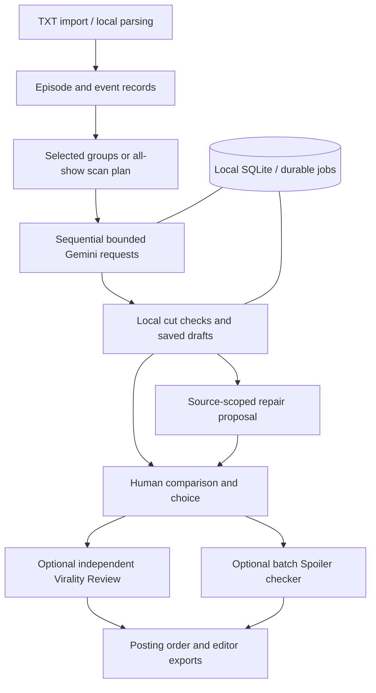

# Promo Studio

Turn timestamped screenplay episodes into source-backed promo cut sheets, with an editor in control.

**Repository:** https://github.com/deep-rubiks003/promo-studio

A working local Python/FastAPI app with a browser interface and Gemini integration. It finds existing dialogue and time ranges; it does not generate footage or render video. Uploading files and previewing a scan use no AI.

## Run locally

Requires Python 3.10+ and a Gemini API key with access to a supported model.

```sh
python -m venv .venv
# Windows: .venv\Scripts\activate
# macOS/Linux: source .venv/bin/activate
pip install -r requirements.txt
python server.py
```

Open http://127.0.0.1:8787 and connect your key privately in the app. Choose an available listed model and your own positive spending limit. Provider quotas still apply. The key stays in server memory and must be reconnected after restart. Saved project data is created locally under data/ and is excluded from this repository. This is a local server application, not a static Netlify upload.

## Two workflows

| Mode | What happens |
|---|---|
| Make promos from chosen episodes | Choose one pooled promo, one per episode, or custom source groups. Each requested promo has one draft. |
| Find promos across the show | All uploaded episodes participate. Each episode gets one actual returned draft where available, with one posting order across the show. |

Import 1–100 timestamped TXT screenplays. Episode numbers and supplied loglines are extracted locally. No automatic genre inference or paid upload analysis is required. Choose continuous or stitched cuts, duration and creative emphasis. The current supported duration is 20–60 seconds.

In full-show mode, **Plan the full-show scan** opens a popup with request and cost estimates. **Find & rank promos** opens ranked cuts and scrolls to the live episode tracker. Processing episodes pulse amber; completed source scans flash green; failed windows are red. Source completion is separate from cut quality.

## Grounding and quality

Cuts reference original episode IDs, time ranges and source events. Dialogue is displayed from the uploaded text, rather than rewritten by the model. Each draft shows hook, context, escalation, cliffhanger and an unanswered question. Five deterministic checks flag source selection, cut structure, duration, boundaries inside timestamped dialogue blocks, and hook evidence within three seconds. These are script checks; they cannot verify footage timing or audience response.

## Detect, repair, review — with human decisions

1. The app checks model output locally and displays concrete failed checks.
2. **Repair failed promos** opens a failed-only picker; select one or several. Repairs run sequentially using the assigned source and recorded failures.
3. Repairs save proposals, preserving the current draft. A comparison popup shows current and proposed cuts and the tradeoff.
4. Choose **Keep current**, **Keep new**, or decide later. A draft may be kept even when checks fail. A missing model draft cannot be accepted as a new cut.
5. Run **Virality Review** explicitly on your chosen draft, even if it has warnings. Changed cuts clear stale assessments; new completed assessments remain visible after reload. Review does not convert failed checks into passes.

This is an AI-assisted correction loop, not a guarantee that the system always fixes itself. The editor can override the suggested cut, retain a weak draft, request another repair, and inspect its actual assessment.

### Review rubric

| Criterion | Weight | Question |
|---|---:|---|
| Hook | 25% | What earns attention immediately? |
| Standalone clarity | 25% | Can a newcomer understand the conflict? |
| Escalation | 15% | Does the situation develop? |
| Cliffhanger | 25% | What meaningful question remains unanswered? |
| Cut quality | 10% | Does it begin and end intelligibly? |

An independent model request judges only the assembled clip and receives local failure warnings. Scores are weighted editorial estimates, **not calibrated viral probabilities**. No review means no invented score. Full-show ordering puts locally passing cuts first, then rated failed cuts and unrated failed cuts, with reasons. User-selected episode cuts remain selected when later ratings change the ordering.

## More editing tools

- **Shape this version:** prompt a source-based recut, such as a more romantic emphasis or stronger hook; compare before keeping it.
- **Spoiler checker:** optional button, never automatic. One batch assessment checks final cuts against their assigned episode context, reusing unchanged stored assessments. It cannot establish spoilers against unseen future episodes.
- **Export:** manual PDF collection and ranked full-show PDF, plus JSON; manual printable editor handoff. Include ordered source cuts, dialogue, beats, unanswered question, available scores, warnings and spoiler findings.
- **Recovery:** durable jobs, checkpoints, Stop generation and explicit Resume. Partial results remain available when quota, connection failure or cancellation interrupts a run.

## Architecture



FastAPI serves the local UI and API. `parser.py` handles screenplay parsing and local checks; `workflow.py` handles manual generation and repair; `discovery.py` plans source windows and episode ranking; `discovery_api.py` exposes discovery actions. `provider.py` and `models.py` handle Gemini requests and configured model costs. `job_runtime.py` persists stages and isolates provider work so Stop can terminate the local worker. `pdf_export.py` builds handoffs locally. No vector database is required.

## API efficiency and failure handling

Only selected sources are sent in manual mode. Full-show mode uses bounded source windows; an episode can require several calls, and a call can contain bounded windows according to the plan. It is not a promise of exactly one request per episode. Completed windows and proposals are checkpointed; unchanged results can be reused. Review and spoiler calls are explicit. Sequential work and bounded provider retries avoid launching a large uncontrolled burst. Failed responses do not erase saved drafts. Spending reservations include attempted failures; unknown provider outcomes can still incur charges. Resume is not a guarantee against external duplicate billing.

Past failures shaped the implementation: quota exhaustion led to durable partial output; rejected drafts being retried without change led to separate repair proposals; ranking silently retaining an older candidate led to explicit comparison decisions; schema variation led to response normalization and source validation; invalid-cut reviews disappearing on reload led to preserving assessments separately from cut validity.

## Verification and limitations

Latest backend regression suite: **147 tests passed** with one existing dependency deprecation warning. Browser checks used an isolated fake provider for both modes, including a failed cut receiving an 80/100 synthetic assessment while remaining flagged. Desktop and phone checks cover popup, progress, comparison and overflow. These are workflow tests, not evidence of real promo performance or a completed paid 100-episode creative benchmark.

```sh
pip install -r requirements-dev.txt
python -m pytest tests -q
```

The project was developed iteratively with AI coding assistance: small scoped changes, source inspection, regression tests, synthetic browser trials and human feedback. It remains a local prototype: no hosted multi-user accounts, no video rendering, and no guarantee of source accuracy beyond the uploaded screenplay. Review and generation may share the configured model; an independent request is not an independent provider.

## Privacy and repository contents

No uploaded screenplays, saved projects, API keys, private run logs or saved outputs are distributed. Runtime data stays local. Keep the bundled font licenses when redistributing PDF functionality. See SECURITY.md, requirements files, tests and docs for implementation details.

See [the updated solution document](docs/SOLUTION.md) for the problem-to-solution walkthrough.
