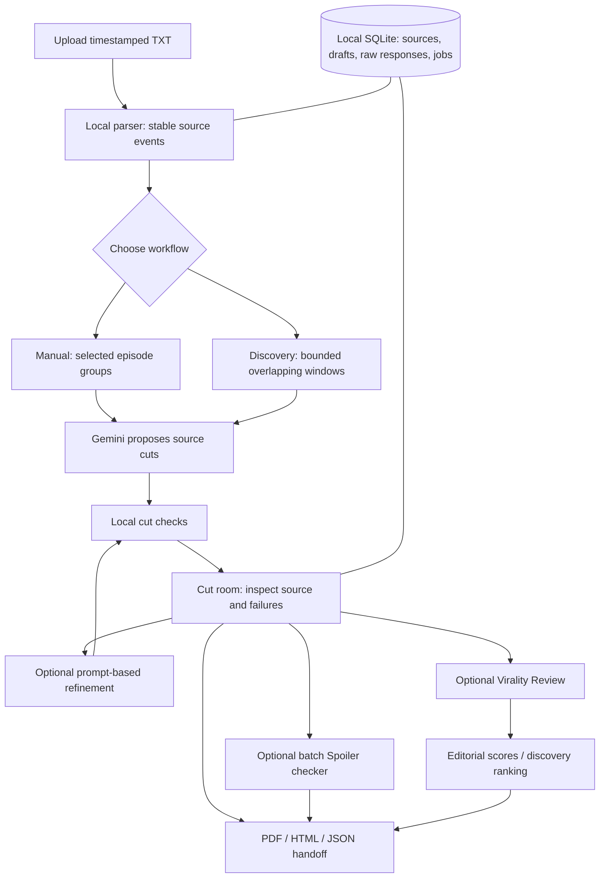

# Promo Studio

**Find short promotional moments in timestamped screenplays, inspect the original dialogue, and hand precise cuts to an editor.**

Promo Studio is a local application built around a practical editorial task: reading many microdrama episodes and identifying moments that could bring a new viewer into the show. It proposes source ranges; it does not render or edit video.

The intended promo is **20–60 seconds**, usually continuous, with an immediate hook, enough context to understand the conflict, and an unresolved ending. A complete scene or emotional arc is not required.

> **Current status:** working local prototype with real API integration, offline regression tests and observed live failures. Some model drafts exceed the duration limit and are correctly flagged. A passing local check is not proof of editorial quality or audience performance. No completed benchmark across the entire private 50-episode input pack is claimed.

## What you can do

| Capability | Behaviour |
|---|---|
| Import screenplays | Upload timestamped UTF-8 TXT files; extract the supplied episode number and logline locally. No model call on upload. |
| Control the source | Select episodes, create one promo from a pool, one per episode, or assign episodes to custom groups. |
| Choose the cut | Request a continuous stretch or stitched ranges. Each manual group produces one draft, rather than three variations. |
| Inspect the proposal | See ordered ranges, original source excerpts, hook/context/escalation/cliffhanger, unanswered question, posting rationale and local checks. |
| Find promos across a show | Scan bounded, overlapping source windows; inspect coverage and unranked candidates before requesting editorial review. |
| Refine with prompts | Ask for a stronger hook, more romantic emphasis, or another source-based recut. Compare the proposal before applying it. |
| Run Virality Review | An explicit, optional action scores the selected manual cut. Discovery review assesses candidates in bounded batches and creates a ranked shortlist. |
| Check spoilers | An optional batch action checks all final promos against their assigned episodes. It distinguishes necessary setup from exposed outcomes. |
| Recover work | Save sources, drafts, raw responses and job checkpoints locally. Resume interrupted work instead of starting everything again. |
| Hand off to an editor | Export PDF, printable HTML and JSON with source instructions, review information and flagged failures. |

## Run on your laptop

### Requirements

- Python **3.11 or newer**. The upload copy was verified locally on Python 3.13.9; other environments are covered by the included CI configuration, not a claim that every matrix job has already passed.
- A modern browser.
- Internet access for initial dependency installation and Gemini actions.
- Your own compatible Gemini API key for model actions. Importing, inspecting saved work and exporting do not need a key.

### Windows: simplest route

1. Clone or download this repository and extract it.
2. Double-click **`Start Promo Studio.cmd`**.
3. The launcher creates a local `.venv`, installs dependencies, and opens **http://127.0.0.1:8787**.
4. Keep the launcher window open while using the app.

If Windows cannot find Python, install Python and enable **Add Python to PATH**, then reopen the terminal.

### Windows: terminal setup

```powershell
git clone https://github.com/deep-rubiks003/promo-studio.git
cd promo-studio
python -m venv .venv
.\.venv\Scripts\python.exe -m pip install -r requirements.txt
.\.venv\Scripts\python.exe server.py --open
```

Activation is optional; the commands use the virtual environment directly and avoid PowerShell activation-policy issues.

### macOS / Linux

```bash
git clone https://github.com/deep-rubiks003/promo-studio.git
cd promo-studio
python3 -m venv .venv
.venv/bin/python -m pip install -r requirements.txt
.venv/bin/python server.py
```

Open **http://127.0.0.1:8787**. On a minimal Linux machine, PDF export needs DejaVu Sans or another supported system font; see the [runbook](docs/RUNBOOK.md).

### First run

1. Import [`examples/episode-001-synthetic.txt`](examples/episode-001-synthetic.txt). This example is synthetic and is safe to share.
2. Select the episode and set a 20–60 second brief.
3. Click **Connect Gemini**, enter your key privately, select a model available to your account, and choose the spending limit.
4. Generate a draft. The application runs local checks, **not an automatic editorial review**.
5. Inspect the actual source and failures. A model can return an invalid cut; invalid output is not silently trimmed into a passing one.
6. For a locally valid cut, click **Run Virality Review** if you want editorial scores. Run the separate spoiler check if needed.
7. Export the result for human footage/audio verification.

The key stays in server memory and must be reconnected after a restart. Do not put it into source files, screenshots, issues or commits.

## Input format

Use UTF-8 `.txt` files with numeric episode information and complete timestamped blocks:

```text
EPISODE NUMBER: Episode 1
EPISODE LOGLINE: A courier receives a delivery from someone who disappeared.

**MAYA:**
Start: (00:00.00) | End: (00:05.00)
"This parcel has my name on it. I never ordered anything."

**ACTION:**
Start: (00:05.00) | End: (00:08.00)
Maya notices that the sender's signature is dated today.
```

The compact form `[00:00-00:05] MAYA: "..."` is also supported. The app accepts up to **100 files within an 8 MB upload**. Malformed timestamp blocks require correction; dialogue is not silently discarded. Missing loglines are labelled rather than written by AI.

## How it works



### Code handles facts; the model handles judgement

**Code:** parsing, episode selection, timestamps, duration arithmetic, source bounds, dialogue-boundary checks, storage, request budgets, caching and exports.

**Gemini:** selecting a promising moment, explaining the creative rationale, proposing source-based refinements, and optionally assessing editorial quality or spoiler risk.

**Human editor:** checking whether the scene actually works, verifying footage/audio timing, deciding what to publish and measuring audience response.

See [Architecture](docs/ARCHITECTURE.md) for component responsibilities, data flow and recovery, and [Product and problem solving](docs/PRODUCT.md) for the decisions behind the workflow.

## Quality and ranking

The current local cut checks cover:

- Selected-episode scope and source bounds.
- Continuous or stitched structure.
- Total playback duration of 20–60 seconds.
- No segment boundary inside an individual timestamped dialogue block, including overlapping speakers.
- Hook evidence starting within the first three playback seconds.

Adjacent blocks by the same speaker are independent. **Source evidence**, **Story order**, **Standalone story & unresolved ending**, and **Complete editorial review** are not blocking local cut checks. Recognized source excerpts remain available for inspection. The model is still instructed to cite real source and create a coherent sequence; a local pass alone does not prove that it succeeded.

Virality Review is a separate action. It returns five 0–5 scores:

| Criterion | Weight | Review question |
|---|---:|---|
| Hook | 25% | What earns attention immediately? |
| Standalone clarity | 25% | Can a newcomer understand this conflict from the clip? |
| Escalation | 15% | Does the situation develop? |
| Cliffhanger | 25% | What meaningful question remains unanswered? |
| Cut quality | 10% | Does the sequence begin and end intelligibly? |

The weighted score is **editorial potential /100**, not a measured probability of going viral. Unreviewed cuts have no invented score.

After an explicit discovery review, shortlist candidates need at least **70/100** and at least **3/5** for clarity and cliffhanger. Near-duplicate cuts are compared after review; repetition and overlap reduce ranking priority. Automatic quantity stops when the next adjusted score falls below the threshold. A requested cap is an upper bound, not a promise to fill a quota.

Read [Quality, testing and known limitations](docs/QUALITY.md) before interpreting scores.

## API calls and input optimization

| Action | Logical model requests, before transient retries |
|---|---|
| Import, local checks, saved views, exports | 0 |
| Manual drafting | 1 per assigned promo group |
| Refinement | 1 per requested recut; no automatic editorial review |
| Manual Virality Review | 1 for the selected locally valid cut, only when requested |
| Show discovery | 1 per bounded scan batch, plus at most 1 targeted stitching attempt when supported |
| Discovery review | Explicitly requested batches of up to 5 clips, smaller when byte limits require |
| Spoiler checker | 1 batch request for all final promos; unchanged output reuses the saved result |
| Optional selected-episode genre analysis | 1 when explicitly requested |

Repairs and retries add requests. This is not a promise that every run costs a fixed amount.

Optimization keeps parsing local, sends only assigned sources, shares field names across lossless event rows, removes duplicate metadata, trims refinement history, batches spoiler context and reuses completed discovery stages.

Measured source-payload **character** reductions in the development installation:

| Source pack | Before | Implemented | Reduction |
|---|---:|---:|---:|
| Three episodes | 26,273 | 18,544 | 29.4% |
| Fifty episodes | 370,849 | 264,585 | 28.7% |

Original source text, timestamps, speakers, kinds and IDs were retained. These figures are not measured token savings or promised cost/latency reductions. An earlier proposed 43% figure was not achieved by the implemented format. See [Optimization notes](docs/OPTIMIZATION.md).

## Run the tests

```powershell
# Windows
.\.venv\Scripts\python.exe -m pip install -r requirements-dev.txt
.\.venv\Scripts\python.exe -m pytest -q
```

```bash
# macOS / Linux
.venv/bin/python -m pip install -r requirements-dev.txt
.venv/bin/python -m pytest -q
```

The tests use synthetic fixtures and mocked providers; **no Gemini key is needed and no live model requests should occur**. They cover source fidelity, grouping, optional review, bounded discovery, spoiler batching, persistence, cancellation, recovery and exports. GitHub Actions is configured for Windows and Ubuntu with Python 3.11 and 3.13. A workflow file is not evidence that a remote run has passed; check the Actions tab.

## Repository structure

```text
promo-studio/
├── server.py                # FastAPI routes, persistence and job orchestration
├── parser.py                # TXT parsing and local cut validation
├── workflow.py              # Briefs, manual drafts, refinements, spoilers
├── discovery.py             # Bounded show scans, source lookup and ranking
├── discovery_api.py         # Discovery preview/start/resume/view/export routes
├── provider.py              # Gemini HTTP adapter and response parsing
├── models.py                # Configured model IDs and budget rates
├── prompt_payload.py        # Lossless model-facing source serialization
├── job_runtime.py           # Durable jobs and cancellable request workers
├── saved_output.py          # Read-only views of saved output
├── handoff.py               # Printable HTML handoff
├── pdf_export.py            # Local PDF rendering
├── static/                  # Browser UI: HTML, CSS and plain JavaScript
├── examples/                # Public synthetic screenplay
├── tests/                   # Offline tests and synthetic fixtures
├── docs/                    # Architecture, product, optimization and runbook
├── .github/workflows/       # Offline CI configuration
├── requirements.txt
└── Start Promo Studio.cmd
```

At runtime, `data/studio.sqlite3` is created locally and ignored by Git. Set `PROMO_STUDIO_DATA` to choose another data directory; see the runbook.

## Privacy and deployment

This repository contains **application source and synthetic examples only**. It excludes the private screenplay pack, local project database, keys, raw outputs, exported private cuts, caches and old backup files. User-created exports and raw responses can contain confidential screenplay text; keep them out of public uploads.

This is a **single-user localhost application**, not a production multi-user service. GitHub hosts the source, not the running Python server. Uploading only the frontend to a static host will not provide working `/api` routes. Public deployment needs authentication, per-user storage and credential handling, job isolation and an appropriate hosted backend. See [Security notes](SECURITY.md).

## Detailed documentation

- [Product, scope and problem-solving decisions](docs/PRODUCT.md)
- [Architecture and data flow](docs/ARCHITECTURE.md)
- [API calls, payloads, caching and budgets](docs/OPTIMIZATION.md)
- [Quality, testing and honest limitations](docs/QUALITY.md)
- [Setup, configuration and troubleshooting](docs/RUNBOOK.md)

The project was developed with AI assistance: Codex/ChatGPT for planning, implementation and diagnosis; Antigravity for frontend iteration; Superpowers for development discipline; Impeccable for interface direction; and Gemini for runtime editorial tasks. These tools did not replace source inspection, tests or human judgement.
