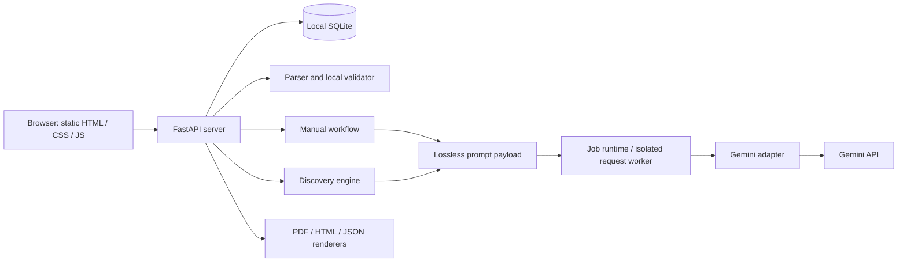
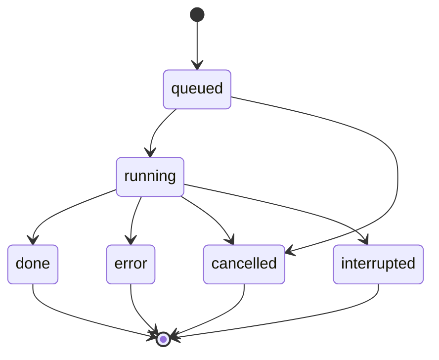

# Architecture

## The small mental model

The browser is an editor's workspace. A local Python server owns the data and jobs. Gemini is called only for explicit model actions. The source remains timestamped throughout: the system proposes which original moments to take, rather than writing new dialogue.



The API key is entered in the local UI and held in server memory. It is passed to a local request worker when needed, not stored in project rows. Restarting requires reconnecting. SQLite stores the sources, drafts, job state, usage accounting, diagnostics and raw provider responses. Those records can contain private content and are excluded from the repository.

## Component responsibilities

| Module | Responsibility |
|---|---|
| `server.py` | Local-only HTTP routes, storage access, user actions, budget accounting and job orchestration. |
| `parser.py` | TXT parsing, stable source IDs, timestamps and deterministic local cut checks. |
| `workflow.py` | Episode groups, generation prompts, normalization, refinements and batch spoiler assessment. |
| `discovery.py` | Source-window planning, scans, exact-ID retrieval, candidate validation, optional review and ranking. |
| `discovery_api.py` | Preview, start, resume, view and export for a discovery run. |
| `provider.py` | Gemini requests, sanitized provider errors and completed JSON extraction. |
| `models.py` | Configured model identifiers, default and conservative accounting rates. |
| `prompt_payload.py` | Pack repeated event fields into labelled rows without shortening source content. |
| `job_runtime.py` | Persist job metadata and run provider work in cancellable local child processes. |
| `saved_output.py` | Read-only projection of checkpointed drafts. |
| `handoff.py`, `pdf_export.py` | Generate human-readable handoff documents locally. |
| `static/` | Import, selection, briefs, cut room, review actions, progress and saved-project UI. |

## Source and cut representation

An episode has a content-derived identifier, number, supplied logline, duration and ordered source events. Each event has an identifier, numeric start/end seconds, speaker, kind and full original text. Kinds include dialogue, action, sound and camera blocks. Manual source material currently filters camera blocks; discovery preserves the supplied source events in its exact windows. Neither path rewrites the original stored episode.

A draft contains ordered `segments` with `episode_id`, `start` and `end`, plus beat citations and editorial metadata. Stitched playback follows the listed segment order; source time and playback time are different. For example, a five-second range from one episode followed by a twenty-second range from another makes 25 seconds of playback, regardless of their source timestamps.

Canonical IDs remain unchanged in storage and outputs. The model-facing table form shares column headers instead of repeating JSON keys. Round-trip tests check that it reconstructs the original source values exactly. No approximate summary replaces the actual source text.

## Manual drafting and optional review

```mermaid
sequenceDiagram
    actor Editor
    participant UI as Browser
    participant API as Local server
    participant Model as Gemini
    participant DB as SQLite
    Editor->>UI: Import TXT and choose episodes
    UI->>API: Files and explicit source selection
    API->>DB: Save parsed original source
    Note over API,DB: No model request on import
    Editor->>UI: Generate one draft per group
    API->>Model: Scoped source + brief + editorial guidance
    Model-->>API: Original source ranges and rationale
    API->>API: Local duration, boundary and scope checks
    API->>DB: Save draft and raw response
    API-->>UI: Cut and local check results; score blank
    Editor->>UI: Run Virality Review
    API->>Model: Actual selected clip only
    Model-->>API: Five rubric scores and story assessment
    API->>DB: Save complete validated review
    API-->>UI: Editorial potential /100
```

The review endpoint refuses locally invalid manual cuts before spending a model request. A malformed review response leaves saved review results intact. Review does not change source ranges. A new recut starts without inherited editorial approval; applying it invalidates its previous spoiler result.

The local `eligible` field means the current technical cut checks pass. `editorial_passed` and `rubric_score` are separate. An unreviewed cut can pass local checks and still be editorially weak. JSON export separates reviewed ranking entries from unreviewed source-valid entries.

## Discovery over 50 or 100 episodes

1. Validate the selected source and settings locally.
2. Assign every selected event to a window. Whole events are retained; if one complete turn exceeds the byte budget, fail explicitly rather than truncate it.
3. Bound windows by event start-time span and serialized byte size. Include prior whole turns around the overlap boundary.
4. Batch up to five windows while respecting the source and request byte budgets.
5. Ask for bounded candidate and opportunity lists. Deduplicate identical cuts before review.
6. Optionally retrieve exact source windows linked by opportunity keys or event IDs for one targeted stitching attempt. This is a small deterministic lookup, not exhaustive semantic search.
7. Return unranked source-valid candidates. The editor explicitly triggers review.
8. Review clip-only batches, validate complete response coverage, cache results, and rank candidates using quality and diversity heuristics.

Current constants: 20,000-byte source windows, 48,000-byte source batches, 64,000-byte full prompt ceiling, up to 180 seconds between event starts per window, 60-second overlap, at most three candidates per scan response, and up to five clips per review batch. Limits work together; there is no promise that every request contains five windows or five clips.

Coverage means each selected source event was assigned and its window scan completed. It does **not** prove that every possible promo was found. Since each scan returns a bounded candidate list, exhaustive discovery is not claimed.

## Recovery, cancellation and accounting



Resuming is an explicit new action using saved checkpoints. The app does not silently restart paid work after a reboot. Completed stages can be reused. Request workers can be terminated so Stop prevents later local stages. A request already received by the provider may still be billed; uncertain reservations remain held conservatively.

Only one active local job is allowed. This avoids conflicting mutations in the single-user prototype; it is not a horizontally scaled scheduler.

## RAG and model replacement

There is no embedding index, vector database or external knowledge corpus. This problem already provides ordered timestamped source. Bounded scans and exact-source retrieval retain clearer provenance than introducing a semantic index at this scale. Embeddings could become useful for editor-driven search across a much larger catalogue, but they would still need exact transcript lookup and time-boundary checks.

Changing among configured Gemini models uses the model selector and registry. Supporting another provider requires implementing the adapter, updating model validation/rates and testing response, cancellation and accounting behaviour. It is not a universal one-line switch across vendors.

## What production deployment would add

An authenticated service would need per-user/show isolation, durable shared job queues, scoped credential management, retention/deletion controls, access-controlled exports, provider rate limiting and monitoring. The present localhost origin checks and session token are appropriate boundaries for this local workflow, not a substitute for that production work.
